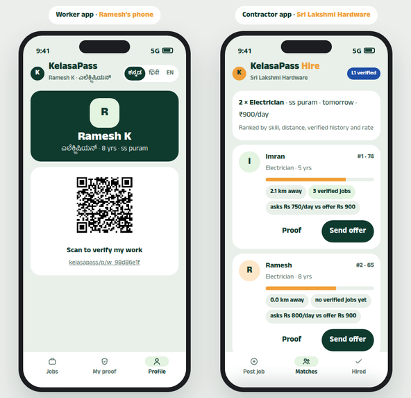
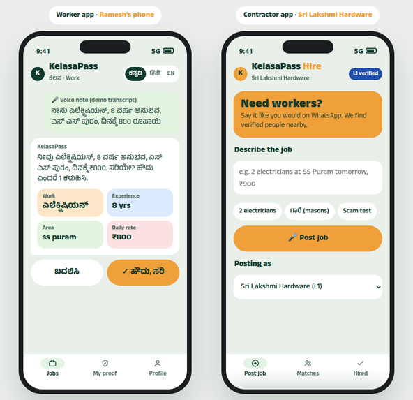
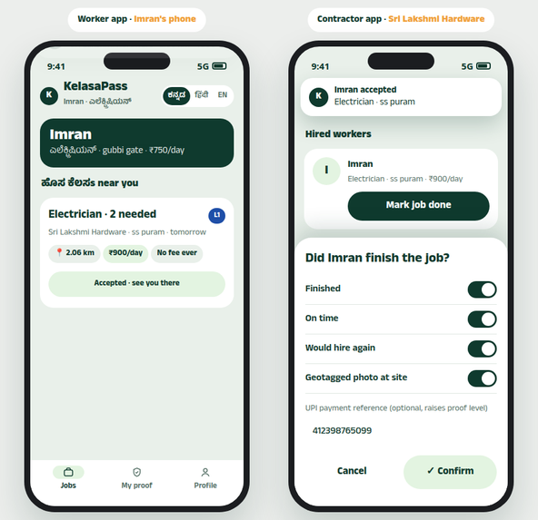
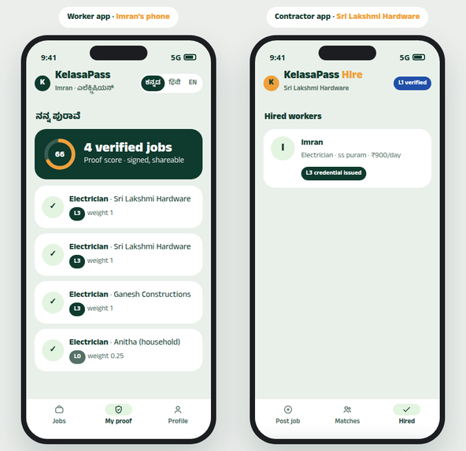
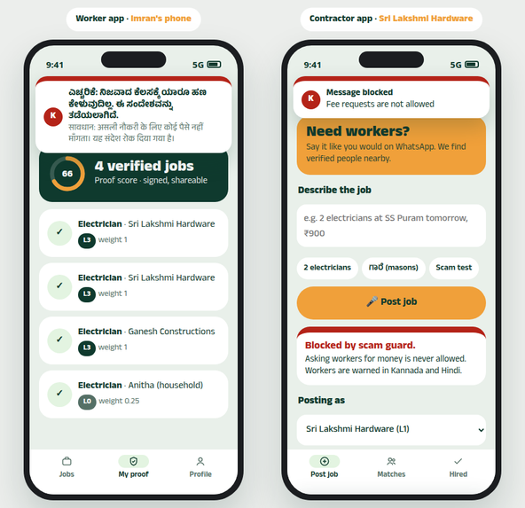
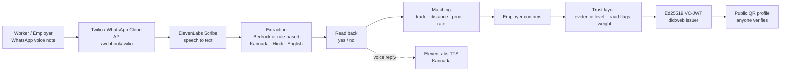

# KelasaPass

**Every finished job becomes proof.**

KelasaPass (*kelasa* is Kannada for "work") is a voice-first job matching and work-proof service for blue-collar workers in non-metro India, starting in Tumakuru, Karnataka. A worker creates a profile by sending one WhatsApp voice note in Kannada or Hindi. Local employers post jobs the same way. Workers are ranked by skill, distance, rate and **verified work history**, and every job an employer confirms as finished becomes a **signed, verifiable credential** that the worker owns and can show anyone.

> wHACKiest 2026 · Track 4 **UnlockED** · Problems **4.1** (Localized Vocational Skill Verification) and **4.3** (Hyper-Local Job Matching)
> Team **Essential Engineers**, Shridevi Institute of Engineering and Technology, Tumkur

**▶ [Watch the 3-minute pitch and demo](https://youtu.be/il9WqZBGC0w)**



## The problem

A mason in Tumakuru with twelve years of experience has no certificate, no resume and no record of his work. Every morning he stands at a labour chowk and hopes to be picked.

- **Skill is unproven.** Only 4.2% of Indians aged 15-59 have formal vocational training (PLFS 2025). Most trade skill is learned on the job and never recorded.
- **The workforce is huge.** 31.89 crore unorganised workers are registered on e-Shram (Aug 2026), 1.07 crore of them in Karnataka (Mar 2025).
- **Hiring is a lottery.** At labour stands, workers wait from 7 am, hiring ends by noon, and who gets picked is chance.
- **Existing tools miss these workers.** Job apps are text-first and built for metro employers. AI recruiters serve large enterprises. One-off skill tests have trust gaps. Job-fee scams target exactly this group.

Nobody gives the worker **portable proof of the work they have actually done**.

## The solution

| Step | Worker | Employer |
|---|---|---|
| 1. Speak | Sends a voice note: "I'm an electrician, 8 years, SS Puram, ₹800 a day" | Sends a voice note: "Need 2 electricians at SS Puram tomorrow, ₹900" |
| 2. Confirm | Hears the profile read back and taps yes (speech recognition is never perfect) | Sees ranked workers, each with plain reasons |
| 3. Match | Gets the job alert and accepts it | Sends an offer to the best match |
| 4. Prove | Receives a signed credential and a higher proof score | Taps "finished, on time, would hire again", optionally with a UPI reference |

No app to install, no typing and no English needed. The worker never pays.

| Voice onboarding | Employer confirms the job | Verified proof on the worker's phone | Scam blocked |
|---|---|---|---|
|  |  |  |  |

## Why the proof is trustworthy

A signature proves who issued a credential, not that the claim is true. So KelasaPass scores the **evidence** behind each confirmation instead of using star ratings:

| Level | Evidence | Weight |
|---|---|---|
| L0 | Employer verified by phone only | 0.25 |
| L1 | Employer business identity checked (Udyam / GST) | 0.5 |
| L2 | Payment-linked: UPI reference for this job | 0.8 |
| L3 | L2 plus a geotagged photo within 1 km of the job site | 1.0 |

Fraud signals cut a credential's weight: same device or phone as the worker, self-attestation, bursts of confirmations, repeated confirmations by the same employer, and new unverified employers. In the built-in collusion demo, five fake confirmations from the worker's own phone add up to a weight of **about 0.02**, against **1.0** for one honest L3 job.

The **scam guard** blocks job posts that ask workers for a registration or joining fee, and warns workers in Kannada and Hindi.

## How matching works

For each confirmed, available worker in the same trade within 10 km:

```
score = 0.45 × (1 − distance / 10 km) + 0.35 × proof + 0.20 × rate_fit
proof = 1 − exp(−Σ credential weights / 3)   # diminishing returns, cannot be farmed
```

Every match comes with reasons the bot can say out loud: "2.1 km away · 3 verified jobs · asks ₹750/day vs offer ₹900". In the demo, Imran ranks above a closer worker because his past jobs are payment-verified.

## Architecture



- **Credentials:** W3C Verifiable Credentials (VC 2.0 data model) as Ed25519-signed VC-JWTs. The issuer key is published as `did:web` at `/.well-known/did.json`, so anyone can verify a credential without calling us. The profile page has a **Verify signature** button and a **Tamper test** (change one character and the signature fails).
- **Voice:** ElevenLabs Scribe for Kannada/Hindi speech-to-text and ElevenLabs TTS for spoken replies. Model IDs come from environment variables.
- **Extraction:** Amazon Bedrock when configured; otherwise a rule-based multilingual extractor that handles Kannada and Devanagari digits, trade names in three languages, Tumakuru localities, wages, worker counts and days.
- **Planned AWS deployment:** API Gateway + Lambda, DynamoDB (replacing SQLite), S3 for media and profile pages, Bedrock, and Secrets Manager for the signing key, in ap-south-1.

## Business model

- **Workers:** always free.
- **Contractors and shops:** pay per confirmed hire, only when the job actually happened.
- **Institutions** (construction welfare boards, skilling programmes, lenders): pay for verified work records, with the worker's consent.

**Rollout:** one labour chowk in Tumakuru, then Tiptur and Sira, through hardware stores and contractors who already hire there.

## Run it

No API keys are needed. Without keys the app runs fully offline with demo voice notes and rule-based extraction.

```bash
pip install -r requirements.txt
uvicorn app.main:app --port 8000
```

Open **http://localhost:8000** to see the worker app and the contractor app side by side as phones. Tumakuru demo data loads automatically.

**Two-minute demo**
1. **Worker phone:** tap the mic (demo mode plays a Kannada voice note). The profile is read back; tap **ಹೌದು, ಸರಿ** (yes).
2. **Contractor phone:** pick "2 electricians" and tap **Post job**. Matches arrive ranked with reasons.
3. Tap **Send offer** on Imran. His phone gets the alert; tap **ಒಪ್ಪಿಕೊಳ್ಳಿ** (accept).
4. On the contractor phone, open **Hired**, tap **Mark job done**, keep the UPI reference and tap **Confirm**. Imran's phone shows the verified-job stamp, and **My proof** shows the signed credential.
5. Pick **Scam test** and post. The job is blocked, and the worker is warned in Kannada and Hindi.

The developer console at **/console** shows the trust panel, the collusion attack demo and the event log. Each worker's public QR profile is at `/p/<worker_id>`.

**Tests**

```bash
python -m pytest -q
```

These cover Kannada and Hindi extraction, the scam guard, ranking by verified history, credential signing and tamper detection, the collusion attack, the WhatsApp webhook flow, Twilio signature validation and the did:web document.

## Turn on voice, WhatsApp and AWS

Copy `.env.example` to `.env` and set what you need:

- **ElevenLabs:** `ELEVENLABS_API_KEY`, `ELEVENLABS_STT_MODEL`, `ELEVENLABS_TTS_MODEL`, `ELEVENLABS_VOICE_ID`.
- **AWS Bedrock:** `BEDROCK_MODEL_ID` plus AWS credentials.
- **WhatsApp (Twilio sandbox):** point the webhook to `https://<host>/webhook/twilio` and set `PUBLIC_BASE_URL`. Once `TWILIO_AUTH_TOKEN` is set, every webhook request must carry a valid `X-Twilio-Signature`.

## Repository layout

| Path | What it does |
|---|---|
| `app/extract.py` | Voice/text to structured profile or job (Kannada, Hindi, English; Bedrock optional) |
| `app/matching.py` | Ranking with distance, proof score and rate fit, plus spoken reasons |
| `app/trust.py` | Evidence levels, collusion flags, credential weights, scam guard |
| `app/credentials.py` | Ed25519 VC-JWT issue and verify, `did:web` document |
| `app/service.py` | Workflows: onboarding, posting, offers, completion |
| `app/main.py` | FastAPI routes, WhatsApp webhook, voice endpoints |
| `app/voice.py` | ElevenLabs speech-to-text and text-to-speech |
| `app/geo.py`, `app/trades.py`, `app/seed.py` | Tumakuru localities, trade vocabulary, demo data |
| `web/app.html` | Worker and contractor phone apps |
| `web/index.html`, `web/profile.html` | Developer console and public QR profile with signature check |
| `tests/` | Test suite |

## Honest limits of this prototype

- **Mocked:** the Udyam/GST business check (a flag on the employer), UPI payment matching (12-digit format check only) and photo geotags (coordinates passed in).
- **Approximate:** locality coordinates are demo values around Tumakuru.
- **Indicative:** NCO-2015 codes in `app/trades.py` need checking against the official list.
- **Not built yet:** the optional 30-second AI video pre-screen. It will only ever be labelled as a pre-screen and never issue a credential.

## Team Essential Engineers

Shridevi Institute of Engineering and Technology, Tumkur

- Dipankar Chettri (lead)
- Naveen S
- J Bhuvanesh
- Anusha A
